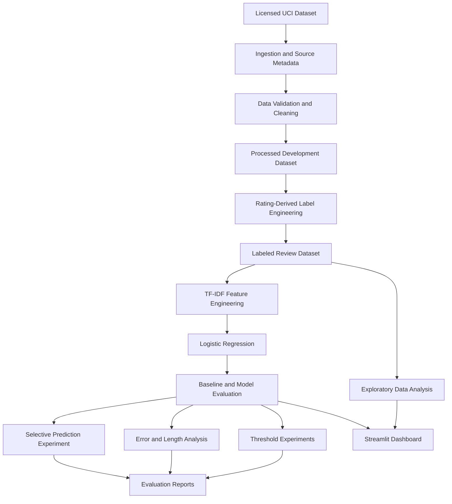

# Freecash Offer Intelligence Engine

### NLP · Machine Learning · Statistical Evaluation · Streamlit · Python

An end-to-end review intelligence prototype that demonstrates how unstructured review text can be transformed into structured sentiment signals, analyzed for patterns, and evaluated using machine-learning and statistical methods.

[**🚀 Live Streamlit Dashboard**](https://freecash-offer-intelligence-engine-febarfvi5xzbav9rp24ymj.streamlit.app/) · [**GitHub Repository**](https://github.com/souravgupta166/freecash-offer-intelligence-engine)

> **Data transparency:** The current implementation uses the UCI Recipe Reviews and User Feedback dataset as a substitute development dataset. It does not contain Freecash or Trustpilot reviews. The application demonstrates an analytical workflow intended to be adapted to reward-platform reviews when appropriately authorized data becomes available.

---

## Table of Contents

1. [Project Overview](#1-project-overview)
2. [Business Problem](#2-business-problem)
3. [Project Objectives](#3-project-objectives)
4. [Architecture and Workflow](#4-architecture-and-workflow)
5. [Dataset and Data Provenance](#5-dataset-and-data-provenance)
6. [Data Cleaning and Label Engineering](#6-data-cleaning-and-label-engineering)
7. [Exploratory Data Analysis](#7-exploratory-data-analysis)
8. [Mathematical Foundations](#8-mathematical-foundations)
9. [Baseline Model and Evaluation Design](#9-baseline-model-and-evaluation-design)
10. [Feature Engineering: TF-IDF](#10-feature-engineering-tf-idf)
11. [Logistic Regression and Class Imbalance](#11-logistic-regression-and-class-imbalance)
12. [Model Comparison and Selection](#12-model-comparison-and-selection)
13. [Threshold Optimization Experiment](#13-threshold-optimization-experiment)
14. [Error Analysis](#14-error-analysis)
15. [Selective Prediction Experiment](#15-selective-prediction-experiment)
16. [Results and Interpretation](#16-results-and-interpretation)
17. [Streamlit Dashboard](#17-streamlit-dashboard)
18. [Backend Implementation](#18-backend-implementation)
19. [Automated Testing](#19-automated-testing)
20. [Installation and Reproducibility](#20-installation-and-reproducibility)
21. [Deployment](#21-deployment)
22. [Responsible Data Collection](#22-responsible-data-collection)
23. [Limitations](#23-limitations)
24. [Future Improvements](#24-future-improvements)
25. [Technology Stack](#25-technology-stack)
26. [References and Attribution](#26-references-and-attribution)

---

## 1. Project Overview

The Offer Intelligence Engine is a Python-based analytical prototype for transforming review data into measurable insights.

The system combines:

- Data ingestion and provenance tracking.
- Data validation, cleaning, and deduplication.
- Rating-derived sentiment label engineering.
- Exploratory data analysis.
- TF-IDF text representation.
- Multiclass Logistic Regression.
- Class-imbalance-aware evaluation.
- Feature configuration experiments.
- Classification threshold experiments.
- Misclassification and review-length analysis.
- Selective prediction experiments.
- An interactive Streamlit dashboard.
- Automated tests for key data and provenance logic.

The objective is not merely to train a classifier. It is to build a transparent workflow in which modeling decisions are justified by measured results, assumptions are documented, and model limitations are visible.

### Project status

| Component | Status |
|---|---|
| Data ingestion pipeline | Implemented |
| Data preparation and labeling | Implemented |
| Sentiment baseline | Implemented |
| Model comparison | Implemented |
| Threshold experiments | Implemented |
| Error analysis | Implemented |
| Selective prediction experiment | Implemented |
| Streamlit dashboard | Implemented |
| Core automated tests | 28 passing in the recorded test run |
| Authorized Freecash/Trustpilot dataset | Not yet available in this implementation |
| Domain-specific reward-offer model | Future work |

## 2. Business Problem

Reward and earning platforms can generate large volumes of unstructured user feedback. If suitable data is available, review intelligence can help investigate questions such as:

- What problems are users reporting most frequently?
- Are complaints associated with reward tracking, eligibility, verification, or payout processes?
- Which themes appear repeatedly in negative feedback?
- How do review patterns change over time?
- Which cases need manual investigation?
- How reliable are automated sentiment classifications?

These questions require more than a positive-versus-negative label. A useful analytical system needs traceable data, meaningful evaluation metrics, error analysis, and domain-specific validation.

The current project implements the underlying review-analysis workflow using a substitute dataset. It does not yet answer these questions for actual Freecash users.

## 3. Project Objectives

### Analytical objectives

1. Create a reproducible pipeline from source data to processed reviews.
2. Derive supervised proxy labels from available star ratings.
3. Quantify the consequences of class imbalance.
4. Establish a simple, interpretable machine-learning baseline.
5. Compare alternative text-feature configurations.
6. evaluate threshold changes using a separate validation set.
7. Investigate where and why predictions fail.
8. Explore whether a selective-prediction policy is justified.
9. Expose analytical findings through an interactive dashboard.

### Engineering objectives

- Separate ingestion, preprocessing, modeling, evaluation, and presentation.
- Keep dataset provenance and licensing information explicit.
- Use deterministic random seeds in the reported experiments.
- Prevent text-vectorizer fitting on test data.
- Keep raw data and generated model binaries out of the Git repository.
- Test critical data-validation and provenance rules.
- Make deployment requirements and limitations explicit.

---

## 4. Architecture and Workflow

The project follows a staged analytical workflow.



### Workflow stages

**Stage 1 — Ingestion**

Retrieve the licensed UCI dataset, select relevant columns, normalize data types, and create provenance metadata.

**Stage 2 — Data preparation**

Clean review text, validate ratings, remove duplicate records, and save processed data.

**Stage 3 — Label engineering**

Map eligible star ratings to negative, neutral, and positive proxy labels.

**Stage 4 — Exploratory analysis**

Inspect sentiment frequencies, rating distributions, review characteristics, and frequent terms.

**Stage 5 — Model training**

Fit TF-IDF features and a class-weighted Logistic Regression classifier within a scikit-learn pipeline.

**Stage 6 — Evaluation**

Compare the classifier with a majority-class baseline and evaluate metrics beyond accuracy.

**Stage 7 — Experimental analysis**

Compare n-gram configurations, investigate decision thresholds, analyze errors, and test selective prediction rules.

**Stage 8 — Presentation**

Load the processed dataset and evaluation report into the Streamlit dashboard.

---

## 5. Dataset and Data Provenance

### Dataset source

- **Name:** UCI Recipe Reviews and User Feedback Dataset
- **Repository:** [UCI Machine Learning Repository](https://archive.ics.uci.edu/dataset/911/recipe+reviews+and+user+feedback+dataset)
- **DOI:** [10.24432/C5FG95](https://doi.org/10.24432/C5FG95)
- **License stated by dataset record:** CC BY 4.0

The dataset provides recipe-review text and associated feedback fields. It is used here as a substitute dataset for developing and testing review-analysis methods.

It is not representative evidence of the behavior of Freecash users or reward-platform complaints.

### Data fields used

The ingestion pipeline selects relevant fields such as:

| Field | Analytical purpose |
|---|---|
| `text` | Text analysis and classification |
| `stars` | Rating-derived proxy labels |
| `created_at` | Available timestamp information |
| `thumbs_up` | Available review feedback metadata |
| `thumbs_down` | Available review feedback metadata |
| `reply_count` | Available response metadata |

Identifier fields are excluded from the selected analytical dataset.

### Recorded data-preparation results

| Data quality measure | Recorded result |
|---|---:|
| Source rows | 18,182 |
| Duplicate rows removed | 30 |
| Missing review-text values | 5 |
| Processed development rows | 18,147 |
| Unrated rows excluded from supervised labels | 1,693 |
| Labeled rows | 16,454 |

These figures describe the recorded ingestion and labeling run.

The development dataset and labeled dataset serve different purposes. The development dataset retains records for data analysis, while the labeled dataset contains records eligible for supervised classification.

### Provenance

The ingestion pipeline creates a JSON manifest to document source and processing metadata.

Provenance is important because a model's results cannot be interpreted properly without knowing where its data originated, what transformations were applied, and what license or permission basis applies.

---

## 6. Data Cleaning and Label Engineering

### 6.1 Cleaning operations

The pipeline performs the following operations:

1. Selects the required review and feedback columns.
2. Normalizes selected data types.
3. Trims review-text whitespace.
4. Identifies missing or empty review text.
5. Validates the star-rating scale.
6. Removes duplicate records.
7. Saves the processed development dataset.
8. Records source and processing metadata.
9. Creates a labeled dataset for supervised experiments.

Cleaning is applied to improve data consistency, not to assume that every remaining review is meaningful or correctly labeled.

### 6.2 Rating-derived proxy sentiment

The labeling rule is:

| Star rating | Proxy sentiment |
|---|---|
| 1 or 2 | Negative |
| 3 | Neutral |
| 4 or 5 | Positive |
| 0 or missing | Unlabeled; excluded from supervised training |

Let \(r_i\) denote the star rating of review \(i\). The proxy-label function is

\[
y_i =
\begin{cases}
\text{negative}, & r_i \in \{1,2\}\\
\text{neutral}, & r_i = 3\\
\text{positive}, & r_i \in \{4,5\}\\
\text{unlabeled}, & r_i = 0 \text{ or missing}
\end{cases}
\]

This rule transforms an available rating into a class label.

**Important limitation:** a rating is not a direct annotation of the words in a review. A highly rated review can contain criticism, and a low-rated review can contain positive language. Consequently, the model learns to predict rating-derived categories from text, not objectively verified human sentiment.

### 6.3 Labeled class distribution

The recorded labeled dataset contains:

| Class | Records | Percentage |
|---|---:|---:|
| Positive | 15,453 | 93.92% |
| Negative | 512 | 3.11% |
| Neutral | 489 | 2.97% |
| **Total** | **16,454** | **100%** |

For class \(c\), the proportion is

\[
p_c = \frac{n_c}{N}
\]

where \(n_c\) is the number of records in class \(c\) and \(N\) is the total number of labeled records.

For the positive class:

\[
p_{\text{positive}}
= \frac{15453}{16454}
\approx 0.9392
\]

Approximately 93.92% of the labeled dataset is positive. This severe imbalance strongly influences model evaluation and is the reason accuracy alone is insufficient.

---

## 7. Exploratory Data Analysis

Exploratory data analysis (EDA) is used to understand the data before interpreting model performance.

### Analyses performed

- Distribution of proxy sentiment labels.
- Distribution of star ratings.
- Review-text search and filtering.
- Review-length calculations.
- Frequent unigrams and bigrams.
- Misclassification inspection.
- Model evaluation by review-length group.

### Review length

For review \(i\), let \(t_i\) be the processed text. Character length is

\[
L_i = |t_i|
\]

where \(|t_i|\) is the number of characters in the processed review text.

Review length is examined as a potential factor associated with classification performance. It is not assumed in advance that longer reviews are always easier to classify.

### Term-frequency exploration

The dashboard uses `CountVectorizer` to identify frequent words and word pairs.

This provides descriptive evidence about the text, not proof that a particular word causes a rating or complaint.

A frequent term may appear in positive, neutral, and negative reviews. Its meaning depends on context and co-occurring language.

---

## 8. Mathematical Foundations

This section documents the principal statistical and machine-learning concepts used in the implementation.

### 8.1 Supervised classification

The model receives review text \(x_i\) and its rating-derived label \(y_i\).

The training dataset is

\[
D = \{(x_i,y_i)\}_{i=1}^{N}
\]

The objective is to learn a prediction function

\[
\hat{y}_i = f(x_i)
\]

that maps a review to one of the three proxy sentiment classes.

The predicted class is compared with the held-out proxy label during evaluation.

This is supervised classification because the training examples have labels. It is not unsupervised sentiment discovery.

### 8.2 Train/test separation

The main baseline experiment uses a stratified 80/20 train/test split with `random_state=42`.

With 16,454 labeled records, the recorded split contains:

- Training set: 13,163 rows.
- Test set: 3,291 rows.

Stratification preserves approximately the same class proportions in both partitions.

The training set is used to fit the model. The test set is reserved for final evaluation of that experiment.

The TF-IDF vectorizer is fitted only on training data through a scikit-learn pipeline. This prevents the vocabulary and inverse-document-frequency statistics from being learned from the test set.

### 8.3 Confusion matrix

For three classes, the confusion matrix is a \(3 \times 3\) table.

The entry \(C_{ij}\) represents the number of observations whose actual class is \(i\) and predicted class is \(j\).

The diagonal contains correct classifications. Off-diagonal entries represent errors.

For the baseline classifier, the recorded confusion matrix is:

| Actual class | Predicted negative | Predicted neutral | Predicted positive |
|---|---:|---:|---:|
| Negative | 65 | 14 | 23 |
| Neutral | 23 | 46 | 29 |
| Positive | 60 | 96 | 2,935 |

This table reveals errors that a single aggregate score would conceal. In particular, many neutral and negative reviews are predicted as positive.

### 8.4 Accuracy

Accuracy is the fraction of all predictions that are correct:

\[
\text{Accuracy}
= \frac{\sum_c TP_c}{N}
\]

For the baseline classifier:

\[
\text{Accuracy}
= \frac{65+46+2935}{3291}
\approx 0.9256
\]

The result is approximately 92.56%.

Accuracy is easy to interpret but can be misleading when one class dominates the dataset.

### 8.5 Precision

For a class \(c\), precision measures the fraction of predictions assigned to that class that are correct:

\[
\text{Precision}_c
= \frac{TP_c}{TP_c+FP_c}
\]

A high precision for the negative class means that predicted negative reviews are relatively likely to belong to the negative proxy class.

Precision does not measure how many actual negative reviews were found.

### 8.6 Recall

Recall measures the fraction of actual examples of a class that the model identifies:

\[
\text{Recall}_c
= \frac{TP_c}{TP_c+FN_c}
\]

For a review-intelligence application, low negative-class recall can be important because potentially relevant negative reviews may be missed.

In this project, recall is measured against rating-derived proxy labels, not verified complaint annotations.

### 8.7 F1 score

The F1 score is the harmonic mean of precision and recall:

\[
F1_c =
2 \cdot
\frac{\text{Precision}_c \cdot \text{Recall}_c}
{\text{Precision}_c+\text{Recall}_c}
\]

The harmonic mean penalizes a large imbalance between precision and recall.

F1 is useful when both missed examples and incorrect positive predictions matter.

### 8.8 Macro F1

Macro F1 computes the F1 score separately for each class and averages the class scores equally:

\[
\text{Macro F1}
= \frac{1}{K}\sum_{c=1}^{K} F1_c
\]

Here, \(K=3\).

Each class contributes equally, regardless of its number of records. Macro F1 therefore makes weak minority-class performance visible.

### 8.9 Weighted F1

Weighted F1 averages class-level F1 scores according to their support:

\[
\text{Weighted F1}
= \sum_{c=1}^{K}
\frac{n_c}{N}F1_c
\]

where \(n_c\) is the number of actual test examples in class \(c\).

Because the positive class dominates this dataset, weighted F1 is strongly influenced by positive-class performance.

### 8.10 Balanced accuracy

Balanced accuracy averages recall across the classes:

\[
\text{Balanced Accuracy}
= \frac{1}{K}
\sum_{c=1}^{K}\text{Recall}_c
\]

This metric gives each class equal weight.

A classifier that predicts positive for every review can achieve high overall accuracy but only approximately one-third balanced accuracy on a three-class dataset with examples from all three classes.

### 8.11 Why multiple metrics are necessary

The metrics answer different questions:

| Metric | Main question |
|---|---|
| Accuracy | What fraction of all predictions is correct? |
| Precision | How reliable are predictions for a particular class? |
| Recall | How many actual examples of a class are found? |
| Macro F1 | How well does the model perform across classes equally? |
| Weighted F1 | How well does the model perform, weighted by class frequency? |
| Balanced accuracy | How well does the model identify each class on average? |

For this dataset, balanced accuracy and macro F1 are especially important because positive examples account for approximately 93.92% of the data.

---

## 9. Baseline Model and Evaluation Design

A model should not be judged in isolation. It needs a reference point.

### Majority-class baseline

The project uses a `DummyClassifier` with the most-frequent strategy.

This baseline predicts the majority class rather than learning meaningful text patterns.

Its purpose is to answer:

> Does the text classifier offer a measurable improvement over a trivial strategy?

The recorded majority-baseline metrics are:

| Metric | Majority baseline |
|---|---:|
| Accuracy | 93.92% |
| Balanced accuracy | 33.33% |
| Macro F1 | 32.29% |
| Weighted F1 | 90.98% |

The high accuracy is a direct consequence of class imbalance. Predicting the positive class for every example performs well on the dominant class while failing to identify the other classes.

The baseline therefore establishes why an accuracy-only model-selection strategy would be inappropriate.

---

## 10. Feature Engineering: TF-IDF

Raw text cannot be passed directly into a conventional Logistic Regression classifier. It must first be represented numerically.

The project uses Term Frequency–Inverse Document Frequency (TF-IDF).

### 10.1 Term frequency

Term frequency measures how often a term appears in a document.

A basic definition is

\[
TF(t,d) = f_{t,d}
\]

where \(f_{t,d}\) is the count of term \(t\) in document \(d\).

Implementations can use alternative term-frequency normalizations. The project uses scikit-learn's `TfidfVectorizer` defaults unless explicitly configured otherwise.

### 10.2 Inverse document frequency

Inverse document frequency reduces the relative importance of terms that appear in many documents.

The smoothed scikit-learn form is

\[
IDF(t) =
\log\left(\frac{1+N}{1+DF(t)}\right)+1
\]

where:

- \(N\) is the number of documents in the fitted corpus.
- \(DF(t)\) is the number of documents containing term \(t\).

A term appearing in almost every document receives less discriminative weight than a term appearing in fewer documents.

The formula uses smoothing to avoid division by zero.

### 10.3 TF-IDF weight

The unnormalized weight is

\[
w_{t,d} = TF(t,d)\cdot IDF(t)
\]

The vectorizer applies its configured normalization to create the final document representation.

TF-IDF is a weighting method, not a sentiment model by itself. It creates numerical features for the classifier.

### 10.4 Unigrams and bigrams

A unigram is one token, such as:

- `slow`
- `payment`
- `excellent`

A bigram is a two-token sequence, such as:

- `very slow`
- `great recipe`
- `not working`

Bigrams can preserve local context that individual words lose. For example, `not working` expresses a different idea from `working`.

However, bigrams increase the number of candidate features and can produce sparse representations. Their value must therefore be evaluated empirically.

### 10.5 Why TF-IDF was selected

TF-IDF was selected as a practical, interpretable baseline because it:

- Works directly with text.
- Produces sparse numerical representations.
- Is efficient for a dataset of this size.
- Supports unigrams and bigrams.
- Integrates with scikit-learn pipelines.
- Provides a useful baseline before considering more complex language models.

The model comparison results later in this README support retaining the unigram-plus-bigram configuration for the recorded experiment.

---

## 11. Logistic Regression and Class Imbalance

### 11.1 Model objective

Logistic Regression estimates class probabilities from the numerical feature vector \(x\).

For a multiclass model, the softmax probability for class \(k\) can be written as

\[
P(y=k\mid x)
=
\frac{\exp(z_k)}
{\sum_{j=1}^{K}\exp(z_j)}
\]

where

\[
z_k = w_k^\top x+b_k
\]

and:

- \(x\) is the TF-IDF feature vector.
- \(w_k\) is the learned weight vector for class \(k\).
- \(b_k\) is the class intercept.
- \(K=3\) is the number of classes.

The probabilities sum to one across the classes.

The default prediction is the class with the highest estimated probability:

\[
\hat{y} = \arg\max_k P(y=k\mid x)
\]

The recorded baseline retains this default argmax decision rule after the threshold experiment did not improve macro F1.

### 11.2 Training objective

Multiclass Logistic Regression can be expressed as minimizing a regularized cross-entropy objective:

\[
J(W,b)
=
-\frac{1}{N}
\sum_{i=1}^{N}
\log P(y_i\mid x_i)
+\lambda R(W)
\]

where \(R(W)\) is a regularization term and \(\lambda\) controls its strength.

The precise optimization implementation depends on the selected scikit-learn solver and parameters.

The project uses scikit-learn's Logistic Regression with balanced class weighting in the recorded baseline experiment.

### 11.3 Balanced class weights

The balanced weighting strategy uses inverse class frequency:

\[
w_c = \frac{N}{K n_c}
\]

where:

- \(N\) is the number of training records.
- \(K\) is the number of classes.
- \(n_c\) is the number of training records in class \(c\).

A class with fewer training examples receives a larger weight.

This makes errors on minority classes contribute more strongly to the training objective than they would under unweighted learning.

Class weighting does not create additional minority examples. It also does not guarantee that minority-class precision or recall will become satisfactory. Performance must still be measured on held-out data.

### 11.4 Why not use accuracy alone?

The majority baseline achieves 93.92% accuracy without meaningful class discrimination.

The TF-IDF classifier has lower accuracy but substantially higher balanced accuracy and macro F1.

This trade-off illustrates an important modeling principle: a lower accuracy can accompany better performance across the minority classes.

---

## 12. Model Comparison and Selection

The project compares two TF-IDF feature configurations using the same recorded 80/20 split.

### Experiment configurations

**Experiment A — Unigrams only**

Each document is represented using single-token features.

**Experiment B — Unigrams plus bigrams**

Each document is represented using single-token and two-token features.

The purpose is to measure whether local word-pair information adds useful predictive signal.

### Recorded results

| Metric | Majority baseline | Unigrams only | Unigrams + bigrams |
|---|---:|---:|---:|
| Accuracy | 93.92% | 88.36% | 92.56% |
| Balanced accuracy | 33.33% | 64.17% | 68.54% |
| Macro F1 | 32.29% | 52.91% | 61.60% |
| Weighted F1 | 90.98% | 90.76% | 93.40% |

### Interpretation

Adding bigrams improved the recorded metrics compared with unigrams alone:

- Accuracy increased from 88.36% to 92.56%.
- Balanced accuracy increased from 64.17% to 68.54%.
- Macro F1 increased from 52.91% to 61.60%.
- Weighted F1 increased from 90.76% to 93.40%.

The most important change for this imbalanced task is the improvement in macro F1 and balanced accuracy.

The evidence supports retaining unigram-plus-bigram features for this experiment. It does not prove that bigrams are universally superior for all review datasets.

### Why the majority baseline is retained

The baseline is not a competing production model. It is a control that shows how much apparent performance can result from the class distribution alone.

Without this reference point, a 92.56% accuracy result might look excellent despite weak minority-class performance.

---

## 13. Threshold Optimization Experiment

### 13.1 Objective

The baseline uses the default argmax rule. A separate experiment investigates whether changing class decision thresholds can improve macro F1.

This is a different experiment from changing the TF-IDF n-gram configuration.

### 13.2 Validation design

The threshold experiment uses a stratified 60/20/20 split:

- Training set: 9,872 rows.
- Validation set: 3,291 rows.
- Test set: 3,291 rows.

The training set fits the vectorizer and classifier. The validation set is used to select thresholds. The test set is used to evaluate the selected configuration.

Separating these roles helps prevent decisions from being tuned directly against the final test results.

### 13.3 Threshold selection

The recorded experiment selected candidate thresholds of:

- Negative class: 0.45.
- Neutral class: 0.40.

The validation macro F1 for the selected threshold configuration was 0.5962.

Thresholds change how the model's estimated class scores are converted into predictions. They do not change the underlying training data or automatically improve the quality of the learned features.

For multiclass classification, changing individual class thresholds also requires a defined conflict-resolution and fallback policy. A candidate threshold must therefore be assessed as a complete decision rule.

### 13.4 Test-set comparison

| Metric | Default argmax | Tuned thresholds |
|---|---:|---:|
| Macro F1 | 62.63% | 62.58% |
| Balanced accuracy | 67.33% | 66.58% |
| Accuracy | 93.50% | 93.10% |
| Weighted F1 | 94.04% | 93.75% |

### Decision

Threshold tuning did not improve overall macro F1 on the test set. Balanced accuracy, accuracy, and weighted F1 also decreased slightly.

**The default argmax decision rule was retained.**

This is an important negative result: more complicated decision logic was not adopted simply because it was available. The experiment did not provide evidence of an overall improvement.

The threshold results belong to the 60/20/20 experiment and must not be treated as directly interchangeable with the main 80/20 baseline results.

---

## 14. Error Analysis

Aggregate metrics explain how a model performs overall. Error analysis investigates where it fails.

### 14.1 Main baseline error rate

The recorded 80/20 baseline experiment has:

- Test examples: 3,291.
- Correct predictions: 3,046.
- Misclassified predictions: 245.

The error rate is

\[
\text{Error Rate}
= \frac{N_{\text{incorrect}}}{N_{\text{test}}}
\]

Therefore,

\[
\text{Error Rate}
= \frac{245}{3291}
\approx 0.0744
\]

The recorded error rate is approximately 7.44%.

This does not mean that the model is 92.56% accurate at detecting real-world complaints. It means that it correctly predicts the rating-derived proxy labels for 92.56% of this test split.

### 14.2 Errors by actual class

From the confusion matrix:

| Actual class | Incorrect predictions | Support |
|---|---:|---:|
| Negative | 37 | 102 |
| Neutral | 52 | 98 |
| Positive | 156 | 3,091 |
| **Total** | **245** | **3,291** |

The positive class accounts for the largest absolute number of errors because it has far more examples. The negative and neutral classes nevertheless have much weaker class-level performance.

This is why absolute error counts should be considered alongside per-class recall, precision, and F1.

### 14.3 Review-level error inspection

The error-analysis pipeline exports misclassified examples for inspection.

Reviewing examples helps investigate potential causes, such as:

- Very short text with limited context.
- Ambiguous wording.
- Positive and negative language in the same review.
- Negation and multiword expressions.
- A mismatch between review text and its star rating.
- Expressions that depend on context outside the review.

These are plausible error categories to investigate, not proof that each mechanism has been isolated experimentally.

### 14.4 Why this analysis matters

Misclassified reviews can reveal problems hidden by aggregate metrics. They can also inform future annotation guidelines and the selection of a manually reviewed evaluation sample.

The current analysis concerns proxy-label prediction. It does not validate a domain-specific complaint detector.

---

## 15. Selective Prediction Experiment

### 15.1 Objective

Selective prediction allows a model to abstain on cases that are considered unsuitable for automated prediction.

The project explores a simple policy based on minimum review-text length.

The hypothesis is that short reviews may contain less context and could be harder to classify.

### 15.2 Length-group results

The recorded baseline-split analysis produced the following results:

| Review length | Examples | Accuracy | Macro F1 | Error rate |
|---|---:|---:|---:|---:|
| 1–20 characters | 106 | 83.02% | 53.05% | 16.98% |
| 21–80 characters | 553 | 90.05% | 54.13% | 9.95% |
| 81–200 characters | 1,270 | 94.09% | 60.80% | 5.91% |
| 201+ characters | 1,362 | 92.88% | 65.78% | 7.12% |

The shortest-review group has the highest observed error rate. However, the 201+ character group does not outperform the 81–200 character group in accuracy.

These observations suggest an association between text length and performance, but they do not establish a universal relationship or justify a particular abstention threshold.

### 15.3 Coverage and error

Coverage measures the fraction of cases for which the system makes a prediction.

For a threshold \(L_{\min}\),

\[
\text{Coverage}(L_{\min})
=
\frac{\#\{i:L_i\geq L_{\min}\}}{N}
\]

The selective-prediction experiment uses a validation-set error constraint of at most 8% and selects the highest-coverage candidate satisfying that constraint.

The recorded validation selection chose a cutoff of zero, meaning all reviews were retained.

### 15.4 Candidate results

The separate 60/20/20 selective-prediction experiment reported:

| Minimum length | Test coverage | Test error rate |
|---|---:|---:|
| 0 | 100.00% | 6.50% |
| 10 | 99.00% | 6.48% |
| 15 | 98.12% | 6.47% |
| 20 | 97.11% | 6.41% |
| 25 | 95.81% | 6.37% |
| 30 | 94.62% | 6.45% |
| 40 | 92.43% | 6.54% |
| 50 | 89.88% | 6.46% |

The lowest observed test error among these candidates occurs at a cutoff of 25 characters, but selecting that cutoff because it has the best test result would use the test set for model selection.

That would bias the reported test performance.

### Decision

No reliable review-length cutoff was established. The current policy retains all reviews by default.

A future selective-prediction experiment should select its policy using training and validation data, then evaluate the locked policy on an untouched test set. It should also measure class-specific performance and coverage, not error rate alone.

The length-group experiment uses the main 80/20 split, while the selective-prediction experiment uses a separate 60/20/20 split. Their error rates should not be compared as if they came from the same test set.

---

## 16. Results and Interpretation

### Main baseline results

The principal recorded 80/20 experiment produced:

| Metric | Majority baseline | TF-IDF + Logistic Regression |
|---|---:|---:|
| Accuracy | 93.92% | 92.56% |
| Balanced accuracy | 33.33% | 68.54% |
| Macro F1 | 32.29% | 61.60% |
| Weighted F1 | 90.98% | 93.40% |

### What the results establish

1. The labeled dataset is strongly imbalanced.
2. A majority-class classifier can obtain high accuracy without useful minority-class discrimination.
3. TF-IDF with Logistic Regression substantially improves balanced accuracy and macro F1 over the majority baseline.
4. Unigram-plus-bigram features outperform unigram-only features in the recorded comparison.
5. Threshold tuning did not improve the test macro F1 in the separate 60/20/20 experiment.
6. Review-length analysis suggests that very short reviews can be more difficult, but the selective-prediction experiment did not establish a reliable cutoff.
7. The model remains limited by proxy labels, class imbalance, and domain mismatch.

### What the results do not establish

The results do not establish:

- The prevalence of complaints about Freecash.
- The prevalence of payout or tracking problems on any reward platform.
- The accuracy of the classifier on real Freecash or Trustpilot reviews.
- The ability to identify verified fraud, genuine reward failures, or policy violations.
- A production-ready threshold for automated moderation or complaint escalation.

Those questions require appropriately authorized, domain-relevant data and an evaluation design aligned with the actual business objective.

---

## 17. Streamlit Dashboard

The interactive dashboard is available here:

### [Open the Live Offer Intelligence Engine](https://freecash-offer-intelligence-engine-febarfvi5xzbav9rp24ymj.streamlit.app/)

The dashboard is implemented in `app.py`.

### Current features

**Review exploration**

- Filter by proxy sentiment.
- Filter by star rating.
- Search review text.
- Filter by minimum review length.
- Inspect individual review records.
- Export filtered data to CSV.

**Descriptive analytics**

- Display headline dataset metrics.
- Visualize sentiment distributions.
- Visualize star-rating distributions.
- Explore frequent words and bigrams.

**Model evaluation**

- Display baseline test metrics.
- Display class-level evaluation measures.
- Inspect the confusion matrix.
- Explain the limitations of rating-derived labels.

**Data quality and provenance**

- Show source information and relevant data-quality context.
- Make the substitute dataset and labeling assumptions explicit.
- Explain that website accessibility is not authorization for automated data collection.

### Dashboard data dependencies

The dashboard loads:

- `data/processed/uci_recipe_reviews_labeled.csv`
- `reports/sentiment_baseline_evaluation.json`

These files must be present at the paths configured in `app.py`.

The trained `.joblib` artifact is used by the training workflow but is not directly loaded by the dashboard code inspected during development. The dashboard displays the saved evaluation report rather than requiring the serialized model for its current visualizations.

---

## 18. Backend Implementation

The backend is divided into collectors, processing scripts, reports, and tests.

### Data ingestion

`src/collectors/ingest_uci_reviews.py`

Responsibilities:

- Retrieve the UCI dataset.
- Select the relevant fields.
- Normalize values and data types.
- Remove duplicate records.
- Save the processed development dataset.
- Produce a provenance manifest.

### Source registry and access checks

`src/collectors/source_registry.py`

Maintains source configuration and collection-approval status.

`src/collectors/access_checker.py`

Checks URL validity, HTTPS requirements, and basic reachability behavior. A successful HTTP response does not imply authorization to scrape or reuse the source.

### Label engineering

`src/processing/label_reviews.py`

Responsibilities:

- Validate star ratings.
- Map ratings to negative, neutral, and positive proxy labels.
- Exclude unrated records from supervised labeling.
- Save the labeled dataset.

### Provenance

`src/processing/provenance.py`

Creates provenance records and prevents saving an authorization-dependent record unless permission is explicitly confirmed.

This is an application-level guardrail. It is not a legal determination that a data source is authorized.

### Baseline training

`src/processing/train_sentiment_baseline.py`

Trains and evaluates:

- A majority-class dummy baseline.
- A TF-IDF and Logistic Regression pipeline.

The script saves the trained model artifact and baseline evaluation report.

### Feature comparison

`src/processing/compare_tfidf_models.py`

Compares unigram-only features with unigram-plus-bigram features using the recorded main split.

### Threshold experiment

`src/processing/tune_sentiment_thresholds.py`

Uses a separate 60/20/20 experiment to select candidate class thresholds on validation data and compare their held-out performance with default argmax classification.

### Error analysis

`src/processing/analyze_sentiment_errors.py`

Recreates the main split, identifies misclassified reviews, and exports error-analysis files.

### Review-length analysis

`src/processing/analyze_errors_by_length.py`

Calculates accuracy, macro F1, and error rate across review-length groups.

### Selective prediction

`src/processing/evaluate_selective_prediction.py`

Evaluates candidate minimum-length cutoffs and explores a validation-set error constraint.

### Dashboard

`app.py`

Loads the labeled dataset and evaluation report, renders interactive charts and filters, provides review exploration, and exposes CSV export functionality.

---

## 19. Automated Testing

The recorded test suite contains 28 tests, all of which passed in the development environment.

| Test module | Tests | Focus |
|---|---:|---|
| `tests/test_access_checker.py` | 13 | URL validation, HTTPS requirements, timeouts, and network errors |
| `tests/test_label_reviews.py` | 10 | Rating-to-label mapping and invalid-rating handling |
| `tests/test_provenance.py` | 5 | Provenance validation and authorization-dependent saving |
| **Total** | **28** | |

Run the tests with:

```powershell
python -m pytest tests -v
```

The recorded result was:

```text
28 passed
```

The suite verifies selected backend behavior. It does not constitute complete testing of every dashboard interaction, model assumption, data-license requirement, or deployment environment.

---

## 20. Installation and Reproducibility

### Prerequisites

- Python compatible with the declared dependencies.
- Git.
- Internet access for installing dependencies and retrieving the UCI dataset when rerunning ingestion.

Python 3.14.7 was used in the recorded Windows development environment. If a dependency is not compatible with your chosen Python version, use a compatible supported Python environment and document it.

### Clone the repository

```powershell
git clone https://github.com/souravgupta166/freecash-offer-intelligence-engine.git
cd freecash-offer-intelligence-engine
```

### Create and activate a virtual environment

```powershell
python -m venv .venv
.\.venv\Scripts\Activate.ps1
```

### Install dependencies

```powershell
python -m pip install --upgrade pip
pip install -r requirements.txt
python -m pip check
```

### Run the dashboard

```powershell
python -m streamlit run app.py
```

Open the local URL printed by Streamlit.

### Run the test suite

```powershell
python -m pytest tests -v
```

### Reproduce the data preparation

The ingestion script is:

```powershell
python -m src.collectors.ingest_uci_reviews
```

The label-engineering script is:

```powershell
python -m src.processing.label_reviews
```

Inspect the scripts before rerunning them if you want to preserve the existing data artifacts.

### Reproduce the main model experiment

```powershell
python -m src.processing.train_sentiment_baseline
```

### Reproduce the feature comparison

```powershell
python -m src.processing.compare_tfidf_models
```

### Reproduce the threshold experiment

```powershell
python -m src.processing.tune_sentiment_thresholds
```

### Reproduce the error analyses

```powershell
python -m src.processing.analyze_sentiment_errors
python -m src.processing.analyze_errors_by_length
python -m src.processing.evaluate_selective_prediction
```

The reported results depend on the dataset version, preprocessing, split, random seed, and installed library versions. For strict reproducibility, pin the tested dependency versions and preserve experiment configurations.

---

## 21. Deployment

The project includes a live Streamlit dashboard:

[https://freecash-offer-intelligence-engine-febarfvi5xzbav9rp24ymj.streamlit.app/](https://freecash-offer-intelligence-engine-febarfvi5xzbav9rp24ymj.streamlit.app/)

The GitHub repository is:

[https://github.com/souravgupta166/freecash-offer-intelligence-engine](https://github.com/souravgupta166/freecash-offer-intelligence-engine)

### Deployment requirements

For a reproducible deployment:

1. Configure the repository's `main` branch as the source.
2. Set `app.py` as the application entry point.
3. Install dependencies from `requirements.txt`.
4. Ensure the processed labeled dataset is committed or otherwise provisioned.
5. Ensure the evaluation JSON report is committed or otherwise provisioned.
6. Test the deployed application after each relevant code or dependency change.

The current dashboard depends on the processed dataset and baseline report being present at the expected paths. A successful Git push alone does not guarantee that deployment is healthy.

---

## 22. Responsible Data Collection

The original business concept concerns Freecash and Trustpilot reviews. However, automated access and reuse must be consistent with applicable website terms, licensing requirements, and permissions.

The current configuration does not approve automated collection from these services.

Before enabling any real-source collector:

- Obtain the required authorization.
- Prefer an authorized API where available.
- Verify the intended use is covered by the applicable license or terms.
- Record the data source and retrieval time.
- Record the permission basis and transformations.
- Avoid collecting unnecessary personal information.
- Reassess privacy, security, and retention requirements.
- Do not treat public visibility or a successful HTTP response as permission.

The current project uses the UCI dataset to demonstrate the pipeline without claiming unauthorized access to platform-specific reviews.

---

## 23. Limitations

### Data limitations

- The substitute dataset contains recipe reviews rather than reward-platform feedback.
- Proxy labels are derived from star ratings, not independent human sentiment annotations.
- The positive class dominates the labeled dataset.
- Dataset-specific language may not generalize to other domains.

### Modeling limitations

- TF-IDF does not fully represent context, sarcasm, or complex language semantics.
- Logistic Regression is a baseline, not a domain-specific language model.
- Minority-class precision and recall remain limited.
- Threshold experiments did not demonstrate an overall improvement.
- The selective-prediction experiment did not establish a reliable minimum-length cutoff.
- A fixed random split does not establish robustness across time or independent data sources.

### Operational limitations

- The dashboard visualizes a saved evaluation report rather than retraining the model interactively.
- The serialized model artifact is excluded from the repository.
- Dashboard loading and interaction tests should be expanded.
- Dependency versions should be pinned for reproducible deployment.
- The system has not been validated as a production complaint-detection or decision-making service.

These limitations should be addressed before using the system to make operational decisions about real users or reward claims.

---

## 24. Future Improvements

### Data and domain adaptation

- Obtain authorized reward-platform reviews or a suitable licensed dataset.
- Create a domain-specific taxonomy for payout problems, tracking delays, eligibility, verification, account restrictions, and other relevant topics.
- Create a manually reviewed dataset with clearly defined annotation guidelines.
- Measure inter-annotator agreement where multiple annotators are available.

### Modeling

- Compare TF-IDF Logistic Regression with linear SVM and stronger text models.
- Investigate class-specific precision-recall trade-offs.
- Calibrate predicted probabilities if probability-based decisions are required.
- Evaluate models on an independent, domain-relevant test set.
- Use repeated splits or cross-validation for model-selection stability.
- Conduct a more rigorous selective-classification experiment with predefined validation criteria.

### Engineering

- Pin dependency versions.
- Add dashboard integration tests.
- Add data-quality assertions and experiment configuration files.
- Track model versions and evaluation results.
- Improve structured logging and error handling.
- Add continuous integration to run tests on each commit.
- Document dataset and artifact generation commands.
- Establish a documented source-authorization process before enabling any new collector.

### Product capabilities

Once authorized reward-platform data is available, potential future capabilities include complaint-theme discovery, issue-frequency tracking, time-based trend analysis, and a review-triage workflow.

These are future objectives, not features already validated by the current dataset.

---

## 25. Technology Stack

| Area | Technologies |
|---|---|
| Language | Python |
| Data manipulation | pandas, NumPy |
| Machine learning | scikit-learn |
| Text representation | TF-IDF, CountVectorizer |
| Classifier | Logistic Regression |
| Visualization | Plotly |
| Dashboard | Streamlit |
| Dataset retrieval | `ucimlrepo` |
| Web and source checks | requests, BeautifulSoup |
| Model serialization | joblib |
| Testing | pytest |
| Version control | Git and GitHub |
| Deployment | Streamlit Community Cloud |

Some installed packages, including Playwright and spaCy, are part of the development environment; the current baseline modeling workflow primarily uses scikit-learn's vectorizers and classifier.

---

## 26. References and Attribution

1. **UCI Machine Learning Repository — Recipe Reviews and User Feedback Dataset.**  
   [Dataset page](https://archive.ics.uci.edu/dataset/911/recipe+reviews+and+user+feedback+dataset)

2. **Dataset DOI.**  
   [https://doi.org/10.24432/C5FG95](https://doi.org/10.24432/C5FG95)

3. **scikit-learn documentation.**  
   [Text feature extraction](https://scikit-learn.org/stable/modules/feature_extraction.html#text-feature-extraction)

4. **scikit-learn Logistic Regression documentation.**  
   [LogisticRegression](https://scikit-learn.org/stable/modules/generated/sklearn.linear_model.LogisticRegression.html)

5. **scikit-learn model evaluation documentation.**  
   [Model evaluation](https://scikit-learn.org/stable/modules/model_evaluation.html)

6. **Streamlit documentation.**  
   [https://docs.streamlit.io/](https://docs.streamlit.io/)

Dataset attribution and license terms should be preserved when redistributing the dataset. The dataset license does not automatically determine the license of the project's original source code.

---

## Author and Project Links

- **GitHub:** [souravgupta166/freecash-offer-intelligence-engine](https://github.com/souravgupta166/freecash-offer-intelligence-engine)
- **Live dashboard:** [Offer Intelligence Engine on Streamlit](https://freecash-offer-intelligence-engine-febarfvi5xzbav9rp24ymj.streamlit.app/)

*This project demonstrates an end-to-end review-analysis workflow, experimental model evaluation, and responsible data handling. Its current results are specific to the UCI recipe-review dataset and should not be interpreted as findings about Freecash or Trustpilot.*
